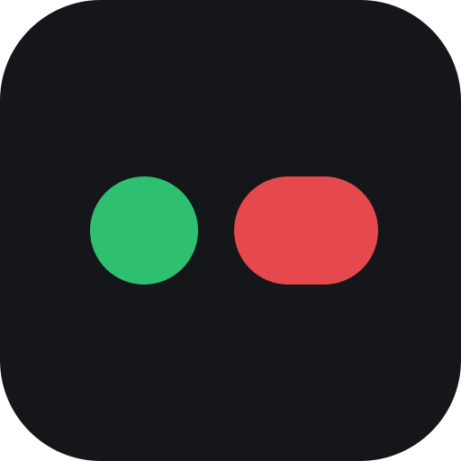

<p align="center">
  
</p>

<h1 align="center">beepcode</h1>

<p align="center">
  Aprende y practica código Morse con un solo pulsador y un árbol que se
  ilumina mientras tecleas: verde el punto, rojo la raya.
</p>

<p align="center">
  
  
  <a href="LICENSE.GPL-3.0.txt"></a>
  <a href="LICENSE.CC-BY-SA-4.0.txt"></a>
</p>

<p align="center"><b>Sin backend, sin conexión, instalable. En el móvil, con ratón o con teclado.</b></p>

> **En desarrollo.** Está hecho el andamiaje (F0): una página "hola"
> instalable. El árbol, el pulsador y el modo Libre llegan con F1. El estado,
> en [`docs/estado.md`](docs/estado.md).

## TL;DR

Solo hacen falta **Docker** (con Compose v2) y **make**. Nada de Node en tu
equipo: todo corre en contenedores.

```bash
make dev    # → http://localhost:5173, con recarga en caliente
```

La primera vez descarga las imágenes y las librerías sola. `make` a secas
lista todo lo demás.

## Qué es

Una versión web de una tarjeta "fidget" para aprender Morse: un único
pulsador, en el que la duración decide si es punto o raya, y el árbol de
decodificación, cuyos nodos se encienden siguiendo lo que tecleas. Y lo que la
tarjeta no tiene: el histórico de lo escrito, un modo para aprender letras y
palabras, otro para reconocerlas de oído, grabar y reproducir, y pasar texto a
Morse. En inglés, castellano, gallego, catalán y euskera.

Todo se queda en tu navegador. La especificación completa, en
[`SPEC.md`](SPEC.md).

## Desarrollo

| Comando | Qué hace |
|---|---|
| `make dev` | Vite con recarga en caliente → http://localhost:5173 |
| `make check` | lint, tipos, tests unitarios, build y la documentación |
| `make e2e` | Playwright, en escritorio y móvil emulado, contra el build en nginx |
| `make ci` | todo, como en GitHub Actions |
| `make web` | el build de producción en nginx → http://localhost:8080 |
| `make npm ARGS="install -D foo"` | npm, en el contenedor |
| `make down` / `clean` / `distclean` | parar; borrar lo generado; y además `node_modules` y las imágenes |

Los ficheros que generan los contenedores son de tu usuario, nunca de root.
En macOS o Windows con Docker Desktop, si la recarga no detecta cambios:
`DEV_POLLING=1 make dev`.

**Para probar la PWA en un móvil de tu red**: `http://192.168.x.x` no es un
contexto seguro y el service worker no se registra (el audio y el táctil sí
funcionan). Dos opciones: `make dev-https` y aceptar el certificado en el
móvil, o la URL de GitHub Pages.

Una vez por clon, `make hooks` instala el pre-commit, que comprueba la
documentación.

## Publicación

Cada push a `main` pasa `make ci` y publica en **GitHub Pages**
(`.github/workflows/deploy.yml`), en `https://1noro.github.io/beepcode/`. En el
repo: **Settings → Pages → Source: GitHub Actions**.

## Documentación

- [`SPEC.md`](SPEC.md): qué se construye y en qué fases.
- [`AGENTS.md`](AGENTS.md): las normas para trabajar en el repo, para personas
  y agentes de IA (Claude Code, OpenCode, Qwen Code).
- [`docs/estado.md`](docs/estado.md): cómo va hoy.
- [`docs/decisions/`](docs/decisions/README.md): por qué es como es.
- [`docs/traducciones.md`](docs/traducciones.md): los idiomas y cómo revisarlos.
- [`CHANGELOG.md`](CHANGELOG.md): los cambios por versión.

## Licencias

- **El código**, [GPL-3.0 o posterior](LICENSE.GPL-3.0.txt).
- **El logo, la documentación y las traducciones**,
  [CC BY-SA 4.0](LICENSE.CC-BY-SA-4.0.txt): se pueden copiar y adaptar citando
  al autor (1noro, beepcode) y compartiendo lo derivado con la misma licencia.
